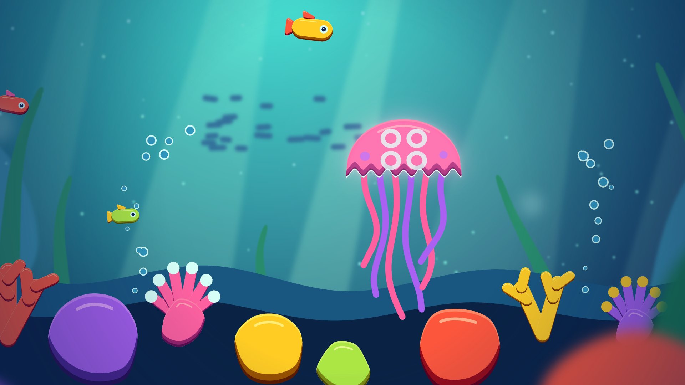
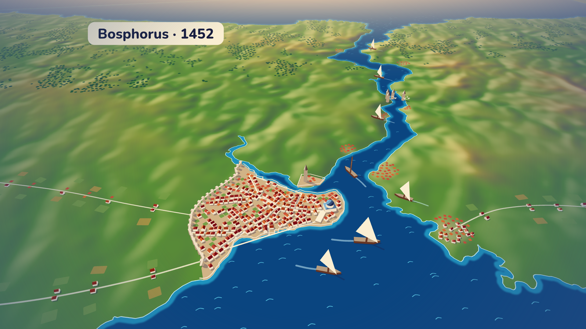
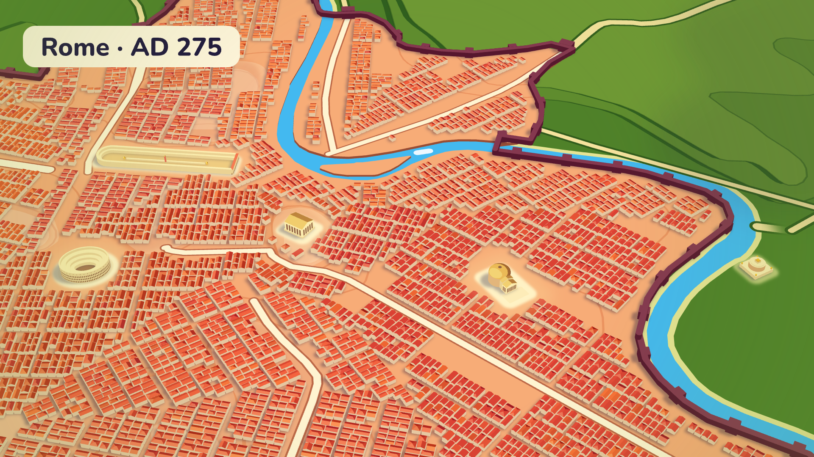

# skink3-engine

A code-first engine for animated science-explainer videos in a flat-vector style. It draws crisp shapes lit automatically, in the colours of the production's palette, with depth of field and glow, and computes their motion with physics at 60 fps. Scenes are TypeScript, written by people or by LLM agents. Skia draws the frames on the GPU without a browser, and they are piped straight into ffmpeg.

<table>
  <tr>
    <td width="50%"><a href="docs/gallery/demo.png"></a></td>
    <td width="50%"><a href="docs/gallery/reef.png"></a></td>
  </tr>
  <tr>
    <td><b>Automatic light, glow and physics:</b> pulses of light run along the links of a network, and a handful of rigid bodies has tumbled into a tray. <a href="examples/demo/scene.ts">examples/demo</a></td>
    <td><b>Depth of field and a living frame:</b> layers in and out of focus, shafts of light, particles, and things that sway, swim and pulse. <a href="examples/reef/scene.ts">examples/reef</a></td>
  </tr>
  <tr>
    <td><a href="docs/gallery/sea.png"></a></td>
    <td><a href="docs/gallery/kites.png"></a></td>
  </tr>
  <tr>
    <td><b>A perspective layer:</b> a sea that runs to the horizon under a camera of its own, with boats, rocks and their mirror images standing in it. <a href="examples/sea/scene.ts">examples/sea</a></td>
    <td><b>Motion as a function of time (<code>drive</code>):</b> kites that wander on the wind, their lines and tails, and a flag whose outline follows it. <a href="examples/kites/scene.ts">examples/kites</a></td>
  </tr>
  <tr>
    <td><a href="docs/gallery/bosphorus.png"></a></td>
    <td><a href="docs/gallery/rome.png"></a></td>
  </tr>
  <tr>
    <td><b>Relief from real heights, and haze:</b> the strait on its real ground, shaded from an elevation model and tinted by height, its far shores fading into the air, a coast of nearly two thousand points with its shallows kept inside it, and sails that stand up from the water. <a href="examples/bosphorus/scene.ts">examples/bosphorus</a> <sub>Elevation and water: produced using Copernicus WorldDEM-30 © DLR e.V. 2010-2014 and © Airbus Defence and Space GmbH 2014-2018 provided under COPERNICUS by the European Union and ESA; all rights reserved.</sub></td>
    <td><b>A city on its real ground:</b> the Aurelian Walls, the Tiber and the landmarks at their mapped outlines, thousands of houses drawn far to near with their shadows, and the light of the relief falling over the city as over the hills round it. <a href="examples/rome/scene.ts">examples/rome</a> <sub>Elevation and the river: produced using Copernicus WorldDEM-30 © DLR e.V. 2010-2014 and © Airbus Defence and Space GmbH 2014-2018 provided under COPERNICUS by the European Union and ESA; all rights reserved. Walls, landmarks and roads: OpenHistoricalMap (CC0).</sub></td>
  </tr>
</table>

Each picture of an example is one frame with neutral content, at 1920×1080, as `still` writes it: `node bin/skink3.mjs still examples/reef/scene.ts --time 5.5` (the demo at 12.3 s, the sea at 5 s, the kites at 4.2 s, the Bosphorus and Rome at 4 s).

## Status

**Working and in use; still growing (November 2026).** Complete videos are made with it in a separate production repository, as 4K masters at 60 fps. There are no releases: a production depends on a checkout of this repository. What the engine does today:

- **Picture.** Circles, capsules, rounded polygons, blobs, free-form regions, links, strokes, labels, free-standing text, counters (on a text or a label; a year written without grouping), eyes (whose pupils may reach past the white, cut by it) and particle emitters. One light per shot makes the shadow crescents, rims, highlights and glow of every shape. Depth layers have parallax, depth of field and atmospheric perspective; a layer can be a space of three dimensions under a camera of its own. A shape can be a cover, a clip, or a vessel whose content rises to a level. A shape or a group can have a soft edge, and what is clipped to it fades out there. A shape or a line can have a height: a block, a plateau or a wall that stands on the ground with its side showing, in a flat layer and in a plane of a perspective layer. Such a body can carry a roof (a gable, a hip, a cone, a dome, or a hip over a free outline that meets in ridges and valleys) and rows of windows or arches on its side, a wall too, and a group of bodies can cast shadows on the ground (under everything in it, or over its streets and squares and under its bodies; laid on the hills of a raised ground from the foot of each body), draw itself far to near for the camera of each frame, with a wall that goes round what stands inside it, and draw the bodies that are small on screen as their tops alone, so that a view of thousands of them stays fast. A line can keep a least width on screen through any zoom. A shape can be a heat haze: the picture behind it wavers like air over heat, and what is drawn after it stays steady. Particles can be drawn as streaks along their way, for rain and sparks. A globe shows a round body from space with the real outlines of its surface (the Earth's land and ice, the Moon's dark seas, from public data through skink3-geo), its night side with the lights there and a rim of air, things that ride it round and hide behind it, and lines drawn on it. A flat map of the whole world, every country to its real borders, or of one country among its neighbours, is drawn from free-form regions and strokes, with outlines from skink3-geo (its `world.mjs` and `worldOnStage`).
- **Motion.** A scene states intents, and the engine adds anticipation, arcs, overshoot and springs: moves, hops, travel along free-form paths, turns, changes of size, opacity, fill, the colour of a line, level and height (blocks that grow out of the ground), lines that draw themselves, outlines that change shape, pulses of light, and `drive` for any motion that is a function of time. The camera drifts (at one speed or at speeds keyed over time), pushes in, follows a path and takes keys.
- **Physics.** Rigid bodies (Rapier 2D) and particles, baked beforehand with fixed seeds.
- **Text and languages.** String tables per language, bundled fonts for Latin, Cyrillic and Greek with a check of every glyph, text that fits itself, runs of a label or a text in a second ink that each language marks in its own string, and subtitles from word timings (.srt, .vtt, .ytt).
- **Sound.** The sound effects of a shot, built from its events and a bank of sounds that a production brings.
- **Reviews without watching.** The motion review, the physics review and the contrast review report their findings as text, with trails, graphs and close-ups.
- **Render.** Drawing processes share one queue across checkouts. On Windows and Linux they reserve RAM and VRAM, and up to four workers draw for each production group. On macOS each takes a place: four long and four short at once. See [the render queue](docs/SCENES.md#the-render-queue).

Not built yet: transitions between shots, soft bodies, ropes, flocks and fluids, motion blur, narration, music and the mix of a film's sound. The full list of what a scene cannot do yet closes [docs/SCENES.md](docs/SCENES.md); what each module does is in [docs/ARCHITECTURE.md](docs/ARCHITECTURE.md), and the roadmap is at the end of this file.

## Why

In this genre, every movement on screen is usually keyframed by hand by a team of animators: anticipation, arcs, overshoot, parts that lag behind, soft impacts, everything a little slower than real life. The engine computes that motion instead of asking anyone to key it:

- **Intent → motion.** A scene says *what* happens ("this node moves there at 6.5 s"). The engine adds what an animator would: a short anticipation, a curved path, overshoot and settle, parts that lag behind on springs, staggered reactions of neighbours, idle drift. Where the shape of the motion is the point, the scene picks it: one speed along a free-form path for a flow, a hop with a known take-off and landing, a level that rises in a vessel.
- **A law of its own, and depth.** Where the motion is a law of the story (an orbit that winds in, a sheet that curls, a frame turned in more dimensions than three and projected), the scene gives it as a function of time, and a node, or the outline of a shape, follows it frame by frame: `drive`. A layer can be a space of three dimensions seen by a camera of its own, which tilts, turns and comes nearer: things stand in it, lie in its planes, turn on hinges, and the nearer is drawn over the farther. Both are opt-in: a shot that asks for neither is the data, and the pixels, it was.
- **Physics where it helps.** Rigid bodies and particles today; soft bodies, ropes, flocks and simple fluids are planned. All of it is deterministic and tuned for readability rather than realism (lower gravity, more drag, softer impacts).
- **Light, not drawing.** One light per shot. The engine builds shadow crescents (a shape minus its shifted copy), lit rims, highlight strokes, stacked shadows and glow from the shape itself. Every crescent is checked, because the path difference behind it is wrong at some offsets: a lit shape never flashes for a frame. A glow can keep its light to itself and leave the sky around it dark, a lit outline with deep bays can leave out its highlight stroke, and the fill of a shape can be keyed from one colour of the palette to another (`fillTo`), its light and its glow following it.
- **Motion that can be reviewed without watching.** An agent cannot watch a video play. The engine knows every node at every frame, so it reports jumps, missing ease, mechanical moves, strobing speed, springs that ring and dead areas of the frame as text, and draws time into single pictures: ghost trails and speed graphs. See [docs/MOTION-REVIEW.md](docs/MOTION-REVIEW.md).
- **Sound in measure.** The sound effects of a shot are built from what happens in it: every intent and every contact is an event, and a bank of sounds that a production brings says what an event sounds like. Only what is seen sounds, and rules keep the track sparse: a sound marks an event that matters, it is not a click every second. A sound can stand apart from those rules, so that a pour is heard impact by impact; a sound can be fitted to a move, its loudest point on the fastest moment of the move and its pan going across with the thing; and a sound sheet shows which event each sound belongs to. The engine holds no sound files. See [docs/SCENES.md](docs/SCENES.md#sound).

## Principles

1. **Deterministic.** Frame *n* is a pure function of the scene, the bake cache and *n*. Everything stateful (physics, particles, springs) is baked beforehand with fixed seeds. Any frame can be rendered alone, chunks render in parallel, and a re-render matches pixel for pixel. On the GPU a frame drawn soon after frames of another zoom may differ from its still by a few pixels of a curved edge, because the drawing library reuses what it kept of their paths; `--alone` draws every frame of a still, a strip or a sheet as it is alone.
2. **Simple forms, flawless motion.** Drawing must be perfect, so motion must be bug-free. The engine avoids objects whose motion viewers know precisely and would instantly judge as wrong. Humanoid limbs are rounded sticks with no hands, fingers or feet, and there are no human limb mechanics (stepping, grasping, gestures). The API has no such parts, so they cannot be drawn by accident. See [docs/PRINCIPLES.md](docs/PRINCIPLES.md).
3. **Text is data.** Scenes never contain on-screen text, only keys into per-language string tables. Labels and free-standing texts size and wrap themselves to the string, and a pre-render check reports overflow and overlaps in every language.
4. **Measured look.** Motion norms are numbers (camera drift, static-frame share, frame rate) checked by `tools/metrics` on renders.
5. **Colour belongs to the production.** The engine holds no colour and no rule about colour. A palette is the scheme of a channel or a series; a production may declare its own rules for it, give a set or a chapter a variant of it, and turn on a review of contrast with its own thresholds.

## Stack

| Layer | Choice | Version |
|---|---|---|
| Language and runtime | TypeScript run directly by Node (built-in type stripping, no build step); `tsc --noEmit` as a check | Node 26, TypeScript 7.0.2 |
| Drawing | [skia-canvas](https://github.com/samizdatco/skia-canvas) — Skia with a Canvas 2D API, GPU (Vulkan/Metal) or CPU | 4.0.0 |
| Rigid bodies | [Rapier 2D](https://rapier.rs), cross-platform deterministic build | `@dimforge/rapier2d-deterministic-compat` 0.21.0 |
| Particles, springs | own code in TypeScript | — |
| Soft bodies, ropes, fluids, flocks | planned: own solvers (XPBD, PBF, boids) in TypeScript | — |
| Video | ffmpeg (x264 by default, NVENC as an option) | 9.x |
| Growth path | a Rust addon (napi-rs) over skia-safe for SkSL shaders, D3D12 and hot physics loops — only where profiling demands it | — |

Why this stack and what was rejected: [docs/STACK.md](docs/STACK.md).

## Quick start

Requirements: Node 26 or newer, ffmpeg on `PATH` (for `render` only).

```
npm ci
npm run check                                             # tsc, unit tests, scene checks of five example shots
node bin/skink3.mjs still examples/demo/scene.ts --frame 450     # one frame       -> out/demo/still_00450_en.png
node bin/skink3.mjs sheet examples/demo/scene.ts                 # contact sheet   -> out/demo/sheet_en.png
node bin/skink3.mjs strip examples/demo/scene.ts --from 388 --count 24 --step 3    # motion strip
node bin/skink3.mjs render examples/demo/scene.ts                # 15 s, 1080p60   -> out/demo/demo_en.mp4
node bin/skink3.mjs render examples/demo/scene.ts --lang x-long  # the same shot in the pseudo-locale
node bin/skink3.mjs motion examples/demo/scene.ts --pictures     # motion review  -> text, out/demo/motion.json, trails and graphs of the worst findings
node bin/skink3.mjs physics examples/demo/scene.ts --pictures    # physics review -> text, out/demo/physics.json, close-ups of the worst findings
node bin/skink3.mjs trail examples/demo/scene.ts --node n2 --time 6.4,8   # ghost trail of a node    -> out/demo/trail_n2_00384-00480.png
node bin/skink3.mjs graph examples/demo/scene.ts --node n2       # speed graph of a node          -> out/demo/graph_n2.png
node bin/skink3.mjs events examples/demo/scene.ts                # what happens in the shot, as events -> out/demo/events.json
node bin/skink3.mjs sfx examples/demo/scene.ts --bank <bank.json>   # its sound track, from a bank of sounds you bring -> out/demo/demo_sfx.wav
node bin/skink3.mjs sfx examples/demo/scene.ts --bank <bank.json> --sheet   # and which event each sound belongs to -> out/demo/sfx_sheet.png
```

`node bin/skink3.mjs help` lists every command and option. Output goes to `./out`, the bake cache to `./cache`, both under the directory the command is run from.

How to write a scene: [docs/QUICK-REFERENCE.md](docs/QUICK-REFERENCE.md) on one page, [docs/SCENES.md](docs/SCENES.md) in full. The smallest one is [examples/minimal/scene.ts](examples/minimal/scene.ts). [examples/flow/scene.ts](examples/flow/scene.ts) is a second, 10-second shot for the things the demo does not have: beads that travel along a path at one speed and vanish behind a cover, a vessel whose content rises to a level, fizz clipped to that content, a creature that hops and squashes, and a camera that goes round a loop, so that a subject stays framed while the camera keeps the speed of a drift, and that pushes in on a moment while the loop goes on. [examples/atlas/scene.ts](examples/atlas/scene.ts) is a third, for lines: a route that draws itself behind a bead, dots that close into a line, a dashed outline and a ring that fills to a share, with a camera that pushes in and pulls back on cue, a title and a note that belong to the frame, a word on a block, bars that grow from their feet, a counter that runs with the route, a cog that spins and slows to rest, and an island with a bay under it all. [examples/drive/scene.ts](examples/drive/scene.ts) has things that follow a function of time, [examples/space/scene.ts](examples/space/scene.ts) a perspective layer, and [examples/globe/scene.ts](examples/globe/scene.ts) the Earth and the Moon from their real outlines: a turn that starts gently, drifting clouds, the lights of towns coming up on the night side, a line drawn round the Earth three times, a craft that flies round the pole and behind the disc. [examples/world/scene.ts](examples/world/scene.ts) lays the whole world on one flat map, a shading spreading over every continent and the countries along the equator deepening to their real borders, and [examples/world/country.ts](examples/world/country.ts) shows one small country among its neighbours, its border drawn round it. [examples/town/scene.ts](examples/town/scene.ts) has bodies on a tilted plane: a round town with rows of houses along ring streets, a tower, a hall with a dome, a hall bent along a ring under a hip that follows its outline, a wall with loopholes, farms with roofs of a low contrast, shadows that lie over the square and the fields, and houses out on the plain that are drawn plain where they are small. The shots of the gallery, each with a palette of its own, are [examples/reef/scene.ts](examples/reef/scene.ts) (under water: depth of field, light from above, emitters), [examples/sea/scene.ts](examples/sea/scene.ts) (a sea at sunset in a perspective layer), [examples/kites/scene.ts](examples/kites/scene.ts) (a windy hill by day: lines, tails and a flag that follow a function of time), [examples/bosphorus/scene.ts](examples/bosphorus/scene.ts) (a strait on its real ground: relief from an elevation model, haze by distance, a long coast with its shallows, ships with standing sails) and [examples/rome/scene.ts](examples/rome/scene.ts) (a city on its real ground: walls, a river, landmarks and roads of a historical map, thousands of houses, relief over the city and the hills). The last two, and the world example, read their ground from files beside them, which their `prepare.mjs` makes again from public data (the Copernicus DEM, OpenHistoricalMap, Natural Earth) with the library [skink3-geo](https://github.com/DanilZabolotskiy/skink3-geo).

### Using the engine from another repository

Productions live in their own repository and depend on a checkout of this one:

```
# in the production repository, next to a checkout of skink3-engine
npm install --save-exact ../skink3-engine      # adds "skink3-engine": "file:../skink3-engine"
npx skink3 check scenes/my-shot.ts
npx skink3 still scenes/my-shot.ts --frame 120
```

Scene modules import from the package name (`import { shot, circle } from 'skink3-engine'`). Two things to know:

- Run `npm ci` in the engine checkout as well: the engine's own dependencies are resolved from there.
- npm links a `file:` directory instead of copying it, and that is required: Node does not strip types from files inside `node_modules`, so a copied engine (`npm install --install-links`) will not load.

## Demo shot

`examples/demo/scene.ts` is 15 seconds of neutral content: a glowing source feeds a small network, and with every wave of pulses its field and then its nodes grow a step; a blob creature drifts in, the network rearranges itself, a tray fades in and a handful of pieces tumble into it, while the camera drifts and pushes in. Measured on November 15, 2026 (Ryzen 7 9700X, RTX 5070 Ti, Vulkan):

| What | Result |
|---|---|
| Bake (17 rigid bodies, 8 springs, 8 emitters, 900 frames) | 0.19 s |
| Render, 1920×1080, 900 frames, 8 worker processes, GPU, x264 | 5.1 s (about 177 frames/s) |
| Same with 1 worker process | 7.0 s (129 frames/s) |
| Same with 8 worker processes on the CPU (`--cpu`) | 15.3 s (59 frames/s) |
| Bake in two separate processes | identical cache hash |
| Frames 0, 450, 899 alone vs inside the full render | identical raw RGBA hashes |
| 1 worker vs 8 workers | identical hashes for all 900 frames |

The GPU path is bit-exact on one machine and driver; it is not expected to match the CPU path or another GPU bit for bit. The frames of that scene keep their zoom: where the zoom of a curved edge changes within a chunk, a frame of the chunk may differ from its still by a few pixels, with where the chunk starts.

The table predates the current queue. An earlier queue with three slots was measured on November 21, 2026, on the same machine while other renders kept its GPU busy:

| What | Result |
|---|---|
| Render, 1920×1080, 900 frames, 8 workers asked, 3 at once | 7.2 s (125 frames/s); 6.9 s (130 frames/s) with the queue off at the same moment |
| Two such renders at once, 3 workers asked by each | never more than 3 workers drawing; the first done in 8.1 s, the second, which waited, in 15.5 s |
| Render, 3840×2160, 240 frames, 3 at once, priority low | 8.0 s (30 frames/s) |
| Queue on vs off; 3 vs 8 workers over 900 frames; 1 chunk vs 6 vs 35 over 240 frames | identical hashes for every frame |

Neither the motion review (`skink3 motion`) nor the physics review (`skink3 physics`) has a finding on the demo. The motion review once had five, all on the creature's antennae, which swing on springs: they snapped out of its body while it popped in and whipped round at the end of its fast move. That was a defect of the spring, found without anyone watching the video, and it is fixed: a swaying stick is now a spring on its angle, which cannot jump and cannot turn more than 57° from its rest direction. To see what the two reviews report, run them on `test/fixtures/defects/scene.ts`, a small shot with planted defects.

The look of the rendered mp4, measured with `tools/metrics` (tone numbers from 30 frames, one every 0.5 s, see [docs/METRICS.md](docs/METRICS.md#short-clips)):

| Metric | Target | Demo shot |
|---|---|---|
| Camera drift, median | 0.3–0.7 px per frame at 1080p | 0.50 |
| Duplicated frames in motion | none | 0 of 733 |
| Fully static frame pairs; longest hold | 3–9 % over a whole video; no hold above ~4 s | 0.0 %; 0.0 s (one continuously moving shot, no cuts) |
| Pixels with L* < 30 | none: the palette's choice | 62.4 % (the demo is a mid-tone shot: V is below 0.3 on about half of its pixels) |
| Saturation of dark pixels | none: the palette's choice | 0.81 |
| Near-gray pixels (S < 0.12) | none: the palette's choice | below 0.1 % |
| Hue of dark pixels | none: the palette's choice | 210–240°: 1 %, 240–270°: 87 %, 270–300°: 12 % |

## Benchmarks

Measured on November 15, 2026, with a Ryzen 7 9700X and an RTX 5070 Ti (Vulkan). The test frame of `bench/render.mjs` is deliberately heavier than an average shot. It has 532 shapes lit with boolean-op crescents, 5,000 particles, three depth layers with blur, a glowing ring with bloom, and text.

| What | Result |
|---|---|
| 4K frame, 1 process, GPU | 130 ms (64 ms of it raster + pixel readback) |
| Same frame, CPU | 320 ms |
| 4K, 8 processes | 45 frames/s |
| 1080p, 8 processes | 78 frames/s, so a 13-minute 60 fps video renders in about 10 minutes |
| Rapier 2D: 2,000 bodies, 4 substeps per frame | 8.5 ms/frame; identical state hash across processes |
| XPBD in JS: 11,200 points, 18,300 constraints, 8 iterations | 10.6 ms/frame |
| 100,000 particles in a force field | 3.2 ms/frame |

```
node bench/render.mjs 1920 gpu 20   # 1080p benchmark frame (writes frame_1920_gpu.png)
node bench/phys.mjs                 # rigid bodies, XPBD and particle timings
```

## Layout

| Path | What |
|---|---|
| `src/core` | time base (60 fps, 1/240 s simulation step), seeded random with named streams, easing, second-order dynamics, seeded noise, stable hashing |
| `src/shape` | circle, capsule, rounded convex polygon and blob as data and as paths; the faces of a roof, the openings of a side and the outline of a side for a body with a height, and the straight skeleton of an outline, on which a hip over a free outline is built; helpers over the path operations, and a crescent that is checked against the area it must have |
| `src/look` | colour math, palette by role with the check of the rules a production declares for it, automatic light (crescents, rim, highlight, glow numbers), atmospheric perspective |
| `src/scene` | scene description types, factory functions (shapes and reliefs as covers, backdrops, clips and contents with a level), compiler (validation, tracks, bake slots), pure evaluation of a frame; globes (a body seen from far away with what stands on it); perspective layers (the space, its camera, its planes) and outlines worked out per frame |
| `src/motion` | intents (`moveTo` with speed profiles, `hop`, `travel`, `popIn`, `popOut`, `turnTo`, `scaleTo` (also with a speed profile), `fadeTo`, `fillTo`, `colorTo`, `levelTo`, `riseTo`, `bump`, `squash`, `drawOn`, `solidTo`, `bendTo`, `widthTo`, `reshape`, `drive`, `countTo`, `pulse`, `openTo`, `blink`, `cameraTo`, `zoomTo`, `perspectiveTo`, `blurTo` (a pull of focus), `backgroundTo`), `stagger`, the curves behind them, free-form paths measured by their length |
| `src/physics` | Rapier wrapper, particles, the bake and its on-disk cache |
| `src/camera` | drift on a heading or along a free-form path, at one speed or at speeds keyed over time, push-in, keys that move and zoom it at a moment, zoom keys under which the drift goes on, parallax view of a depth layer |
| `src/text` | string tables, the bundled fonts and what characters they have, auto-fit layout, runs in a second ink, label geometry, the block of a free-standing text, counters, subtitles from word timings (.srt, .vtt, .ytt) |
| `src/render` | frame compositing on Skia, review sheets, ffmpeg encoding, parallel chunk workers, the render queue of the machine |
| `src/checks` | the rules a palette declares, string tables, the glyphs of every string, text fit per language (errors), labels covering other nodes (warnings), the motion review, the physics review and the contrast review in short form (warnings) |
| `src/review` | the motion review: the series of every node at every frame, the findings and their thresholds, the report, ghost trails and speed graphs. The physics review: the geometry of the colliders, the findings from the bake and their thresholds, the report, close-ups. The contrast review: named nodes against what is seen behind them, with the production's thresholds |
| `src/audio` | the events of a shot, the bank of sounds and its rules, the sound track of a shot (48 kHz stereo), the sound sheet, PCM WAV read and written |
| `src/cli`, `bin/` | the `skink3` command |
| `examples/` | the demo shot, the flow shot, the atlas shot, the drive shot (things that follow a function of time), the space shot (a perspective layer), the town shot (bodies with roofs, openings and shadows on a tilted plane), the globe shot (the Earth and the Moon from real outlines, with the script that takes them from skink3-geo), the shots of the gallery with palettes of their own (reef, sea, kites, and bosphorus and rome on real ground, with the data they read and the scripts that make it) and a minimal scene |
| `test/` | unit and determinism tests (`node --test`) |
| `assets/fonts/` | the bundled font families, each with its licence |
| `bench/` | drawing and physics benchmarks |
| `tools/metrics/` | style and motion metrics for any video — see [docs/METRICS.md](docs/METRICS.md) |
| `docs/` | principles, architecture, stack, scene authoring (the guide and its quick reference), motion review, physics review, metrics; the pictures of the gallery in `docs/gallery/` |

## Roadmap

| Phase | Scope | Done when | State |
|---|---|---|---|
| 0 | A 15-second test shot through the whole path: scene → light → physics bake → GPU render → ffmpeg | the shot reads as the target genre, and its metrics fall in the target ranges | **done** — see the demo shot above |
| 1 | Core picture: more node types, palettes from a mood, camera (spring follow), bubbles, digits that roll, full script coverage with fallback fonts, transitions (the motion review, the physics review, camera paths, camera keys and zoom keys, a background keyed over time, covers, clipping and levels, strokes, free-standing text and counters, free-form regions and outlines that change, fallback fonts for symbols and Greek with a check of every glyph, palettes without rules of the engine's own, a review of contrast, perspective layers and globes are built) | three reference shots (dark, light, microscopic) | in progress |
| 2 | Motion and physics: more intents, simple rigs, ropes, soft bodies, flocks, fluids; kinematic hand-off, goal forces, seed search (speed profiles, hops, travel along free-form paths, turns, travels and a camera whose speed is keyed over time, sizes that change on a speed profile, pulses of light along links and along strokes, squashes, nodes and outlines that follow a function of time, and sound effects from the events of a scene are built) | one demo shot per layer | in progress |
| 3 | Library: generators (L-systems, procedural bodies, scattering), characters under the simple-forms rule, infographics | character and prop sheets | planned |
| 4 | Pipeline: script → narration with word timings → shots → checks → render → subtitles; translation with re-render per language (subtitles from word timings and the sound effects of a shot are built) | a complete video | started |

Architecture: [docs/ARCHITECTURE.md](docs/ARCHITECTURE.md).

## License

The engine's own code, documentation and examples are under the MIT License: see [LICENSE](LICENSE). Copyright (c) 2026 DanilZabolotskiy.

Third-party components keep their own licenses, and the MIT License of the engine does not cover them:

| Component | Its part in the engine | License |
|---|---|---|
| skia-canvas | dependency, installed from npm | MIT |
| Skia | the graphics library inside skia-canvas | BSD-3-Clause |
| Rapier (`@dimforge/rapier2d-deterministic-compat`) | dependency, installed from npm | Apache-2.0 |
| TypeScript, `@types/node` | development dependencies, installed from npm | Apache-2.0, MIT |
| ffmpeg | an external binary the engine calls to encode; not distributed with it | its own: LGPL or GPL, depending on the build |
| Nunito | bundled font, `assets/fonts/nunito/` | SIL Open Font License 1.1, copyright The Nunito Project Authors: [OFL.txt](assets/fonts/nunito/OFL.txt) |
| Noto Sans | bundled font, `assets/fonts/noto-sans/` | SIL Open Font License 1.1, copyright The Noto Project Authors: [OFL.txt](assets/fonts/noto-sans/OFL.txt) |
| Noto Sans Symbols | bundled font, `assets/fonts/noto-sans-symbols/` | SIL Open Font License 1.1, copyright The Noto Project Authors: [OFL.txt](assets/fonts/noto-sans-symbols/OFL.txt) |
| Copernicus DEM GLO-30 and its water body mask | the heights and the water of the Bosphorus and Rome examples, resampled and smoothed: `examples/bosphorus/ground.*`, `examples/rome/ground.*` | free of charge, with credit: produced using Copernicus WorldDEM-30 © DLR e.V. 2010-2014 and © Airbus Defence and Space GmbH 2014-2018 provided under COPERNICUS by the European Union and ESA; all rights reserved |
| OpenHistoricalMap | the walls, landmarks and roads of the Rome example: `examples/rome/ground.json` | CC0 |

The fonts are the files their projects publish, unmodified, each with its licence next to it.
